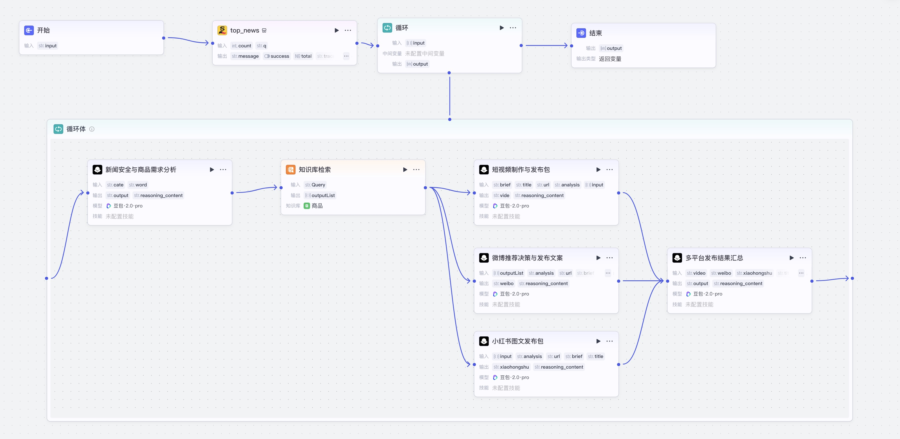

# Midnight Newsroom · 午夜新闻编辑室

> 💡 **项目定位**：以 LLM 为内核、以 Agent 编排为骨架的内容裂变引擎——通过 RAG 增强的新闻理解与可视化工作流编排，把一条原始新闻原子化拆解，再按渠道语义重组为多平台可发布内容包（文案 / 封面 / 分镜脚本）。一次输入，三刊齐发：把「人找内容」的旧范式，重构为「内容适配人」的 Agent 分发流水线。

**核心技术栈：** Next.js 16（App Router）· React 19 · TypeScript 5 · Tailwind CSS 4 · Shadcn/UI · pnpm · `coze-coding-dev-sdk` · 扣子工作流 · SSE（`ReadableStream` + `getReader`）· 自定义语义化 Design Token。

---

## 🚀 核心亮点

### 一、架构设计：一条新闻的「排版分发」流水线

```
新闻原文
   │
   ▼
[Agent 编排层]  扣子工作流（workflow_id=7708734514465439754）
   │  SSE 流式：ready → node×(running/done) → done
   ▼
[解析内核]      output[] 多变体数组 → 每变体 × 三渠道独立状态
   │  ├─ 首段跳过检测（split /[：:,，]/，杜绝原因文本误命中）
   │  ├─ 分镜脚本全局 matchAll(/g) + [^<>]* 拆分（拒单行锚定）
   │  └─ 配图建议 1./2./3./4. → N 个独立 prompt
   ▼
[生成层]        并行调用生图 / 生视频 API（每镜、每图独立状态）
   ▼
[呈现层]        杂志社 × 印刷工坊：三刊并排 / 翻页器 / 跳过印章 / 工作日志
```
### 🛠️ Agent 工作流实机拓扑

为了兼顾业务场景与工程严谨性，本项目底层 Agent 编排完全基于扣子（Coze）工作流引擎实现。工作流通过循环体处理新闻流，并采用「并行分发」架构生成多端内容：

<p align="center">
  
  <br />
  <i>☝️ 扣子（Coze）Agent 编排工作流实机拓扑：包含新闻分析、知识库检索、三端并行生成与结果汇总</i>
</p>

> 💡 **关于工作流复现**：本项目底层 Agent 引擎基于扣子工作流驱动（`workflow_id=7708734514465439754`）。由于平台权限限制无法直接导出 JSON 包，但可完全参考上方截图与拓扑进行复刻：
> 1. **输入解析**：通过 `top_news` 插件获取新闻流。
> 2. **循环分析**：循环体内调用大模型（豆包 2.0-pro）进行新闻安全与需求分析，并结合商品知识库检索。
> 3. **并行生成**：并行分发至「短视频制作」、「微博推荐文案」、「小红书图文」三个大模型节点。
> 4. **结果汇总**：由「多平台发布结果汇总」节点收束，交由前端 SSE 流式解析内核处理。

- **关注点分离的解析内核**（`src/lib/parser.ts`）：把工作流的非结构化输出，收敛为强类型 `Variant -> ChannelState -> ShotState` 数据契约（见 `src/lib/types.ts`）。每变体、每渠道、每镜头均持有独立状态，翻页索引由 `activeIdxByKey` 按渠道维护，**绝不共享全局数组下标**。
- **SSE 实时工作流编排**（`src/app/api/workflow/run/route.ts`）：后端 `ReadableStream` + 心跳保活（`ping`，`cancel` 时 `clearInterval`），首帧立即发 `event: ready` 绕开网关 504；前端 `fetch().getReader()` 打字机式渲染节点进度，让「黑盒 Agent」的每一步都可见、可追溯。
- **弹性降级设计**：真实 API 凭证不可用时，自动切换到确定性待签稿样本，并在工作日志与返回体（`source: placeholder`）如实标注——优雅降级，但绝不伪装成真实生成。

### 二、技术实现：把「工程严谨」写进细节

| 能力 | 实现要点 |
| --- | --- |
| 多变体翻页 | `1/3、2/3、3/3` 按渠道独立状态；翻页不串稿、不复用生成结果 |
| 跳过分支 | 决策**首段**语义判定命中即落「本刊跳过」印章（旋转 -4° / 米底 / 灰描边），签发按钮置灰 |
| 多镜头视频 | 分镜脚本拆为 N 个 9:16 独立镜头，含时长标签与「一键拍摄全镜」并行调度 |
| 多图配图 | N 个 prompt 并行制版，2 列网格铺排，实时显示「印制 X/N」进度 |
| Hydration 防御 | 开发 Inspector 用 `next/dynamic` `ssr:false` 包裹；`<html>/<body>` 加 `suppressHydrationWarning` |
| 语义化 Design Token | 所有色彩 / 字体 / 圆角 / 阴影以 CSS 变量落地，组件零硬编码 hex |

### 三、业务价值：给内容工业化交付的「印刷工坊」

- **对自媒体 / 内容编辑**：把「一条新闻改三版」的重复劳动压缩为一次排版分发，从选题到付印的全流程在一个版面内完成，产能提升一个数量级。
- **对品牌营销**：渠道语义自适应——同一事实在微刊是即时电讯、在种草刊是生活方式叙事、在影刊是分镜脚本，品牌口径统一而表达千人千面。
- **对产品体验**：拒绝蓝紫渐变的 SaaS 套路，用「杂志社 × 印刷工坊」的纸张质感与编辑室工作日志语气（正在排版分发 / 本版已就绪 / 付印），让工具回归内容的温度与创作快感。

产品灵魂与视觉语法详见 [`DESIGN.md`](./DESIGN.md)。

---

## 🛠️ 本地运行

**环境要求**：Node.js ≥ 20、pnpm ≥ 10（本项目使用 pnpm 12，**请勿使用 npm / yarn**）。

```bash
# 1. 安装依赖
pnpm install

# 2. 启动开发服务器
pnpm dev
# 打开 http://localhost:3000
# 完整演示（自动填入示例稿并排版分发）：http://localhost:3000/?demo=1
```

**常用命令**

```bash
pnpm ts-check   # TypeScript 类型检查（0 错）
pnpm lint       # ESLint 检查（0 警 0 错）
pnpm build      # 生产构建
pnpm start      # 启动生产服务
node scripts/selfcheck.mjs  # 离线解析自检（10 卡片：9 有效 + 21 跳过）
```

**接入真实扣子通道（可选）**

在项目根目录新建 `.env.local`：

```bash
COZE_API_TOKEN=your_personal_access_token
```

配置后，工作流编排、生图、生视频将切向真实 API；未配置或凭证不可用时自动降级为待签稿样本，并在工作日志中如实标注。

---

> 排版分发，不智能生成。——Midnight Newsroom
